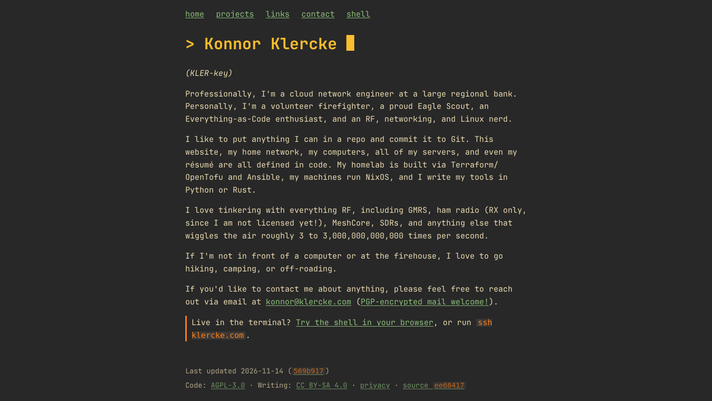
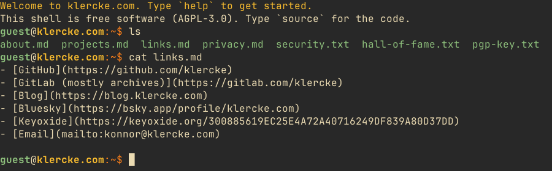

# klercke.com

[](https://github.com/klercke/website/actions/workflows/ci.yml)

Source for [klercke.com](https://klercke.com): a static site built with [Zola](https://www.getzola.org/), plus a terminal version of it you can use [in your browser](https://klercke.com/shell/)...



...or over SSH:

```sh
ssh klercke.com
```



## Layout


| Path    | What it is                                                             |
|---------|------------------------------------------------------------------------|
| `site/` | Zola site: templates, Sass, content                                    |
| `app/`  | Shared Ratatui shell UI; reads its content from `site/` at build time  |
| `web/`  | Browser shell (Ratzilla, WebGL2), built with trunk into `/shell/`      |
| `ssh/`  | `webssh`, the SSH server for the shell (russh)                         |


The shell and the website share one copy of the content.
`app/` embeds the files in `site/content/` and `site/static/` with `include_str!` so they can't drift apart.

## Development

Everything comes from the Nix dev shell (`nix develop`, or direnv with `use flake`), which also installs the pre-commit hooks.


| Command             | What it does                                                   |
|---------------------|----------------------------------------------------------------|
| `just tui`          | Run the shell in your terminal                                 |
| `just serve-web`    | Serve the browser shell alone, with live reload                |
| `just serve`        | Serve the Zola site (run `just build-web` first for `/shell/`) |
| `just ssh-dev`      | Run the SSH server on port 2222; connect with `ssh -p 2222 localhost` |
| `just build-site`   | Build the whole site, browser shell included, into `site/public/` |
| `just build-webssh` | Build `webssh` as a static musl binary                         |
| `just check`        | Formatting, clippy (native and wasm), and tests                |


## Deployment

Every push runs CI: checks, `reuse lint`, the site build, and the `webssh` build.
Pushes to `main` (or a manual run) then deploy the following:

- **Site:** `site/public/` is rsynced to the web server.
- **webssh:** the binary is rsynced to `/srv/webssh/`, where a systemd path unit restarts the service when it changes.

Each deploy uses its own SSH key, restricted on the server to write-only rsync into its own directory.
The `production` environment needs these secrets:


| Secret                  | Purpose                                     |
|-------------------------|---------------------------------------------|
| `DEPLOY_HOST`           | Server hostname                             |
| `DEPLOY_PORT`           | Admin SSH port (webssh owns 22)             |
| `DEPLOY_KNOWN_HOSTS`    | Server host key, for `known_hosts`          |
| `DEPLOY_SSH_KEY`        | Site deploy key                             |
| `DEPLOY_WEBSSH_SSH_KEY` | webssh deploy key                           |


The footer's "last updated" and source links come from `just git-info`, which needs the full Git history (`fetch-depth: 0` in CI).

The server side (Caddy, the systemd units, the firewall) lives in my [homelab-as-code repo](https://github.com/klercke/homelab-as-code).
What it has to provide is below.

### 404 page

Caddy has to serve the 404 page through `templates`, which picks a random quote per request:

```caddyfile
handle_errors {
    @404 expression `{err.status_code} == 404`
    handle @404 {
        rewrite * /404.html
        templates {
            between [[ ]]
        }
        file_server
    }
}
```

Without this, visitors get Caddy's default 404 page.
Without `templates`, the page shows a placeholder instead of a quote.

### Analytics

Plausible is proxied through the site's own domain:

```caddyfile
@plausible path /js/script.js /api/event
handle @plausible {
    rewrite /js/script.js /js/pa-Ol-QVpdHOyuKkkUSi7859.js
    reverse_proxy https://plausible.io {
        header_up Host {http.reverse_proxy.upstream.hostport}
    }
}
```

### webssh

`webssh` serves the shell to anyone, with no authentication.
It refuses exec, subsystems and forwarding, and limits connections per address.


| Variable          | Default                                     | Purpose                     |
|-------------------|---------------------------------------------|-----------------------------|
| `WEBSSH_LISTEN`   | `[::]:22`                                   | Address and port to listen on |
| `WEBSSH_HOST_KEY` | `$STATE_DIRECTORY/ssh_host_ed25519_key`     | Host key, generated if missing |


It takes over port 22, so the host's own sshd has to listen elsewhere.
Binding 22 needs `CAP_NET_BIND_SERVICE`.
It logs to stderr only and writes nothing except its host key.

## License

This repository follows the [REUSE](https://reuse.software/) specification; `REUSE.toml` has the details.

- **Code:** [AGPL-3.0-or-later](LICENSES/AGPL-3.0-or-later.txt)
- **Writing** in `site/content/`: [CC BY-SA 4.0](LICENSES/CC-BY-SA-4.0.txt). Code snippets within the writing are also available under [0BSD](https://spdx.org/licenses/0BSD.html).
- **Data files** (lockfiles, PGP key, `security.txt`, hall of fame): [CC0 1.0](LICENSES/CC0-1.0.txt)
